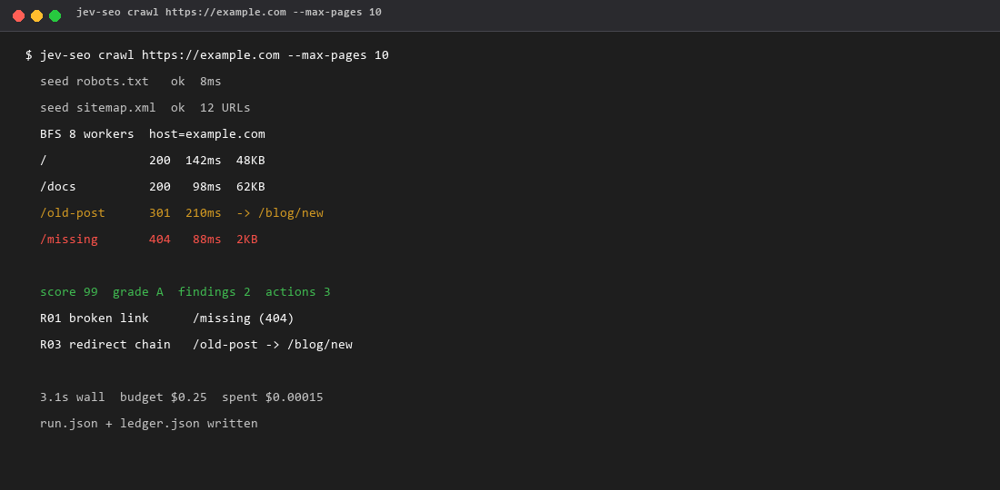
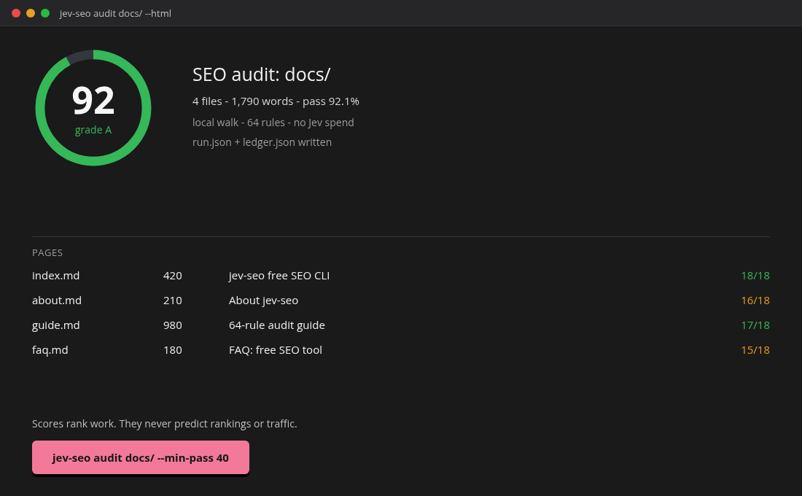
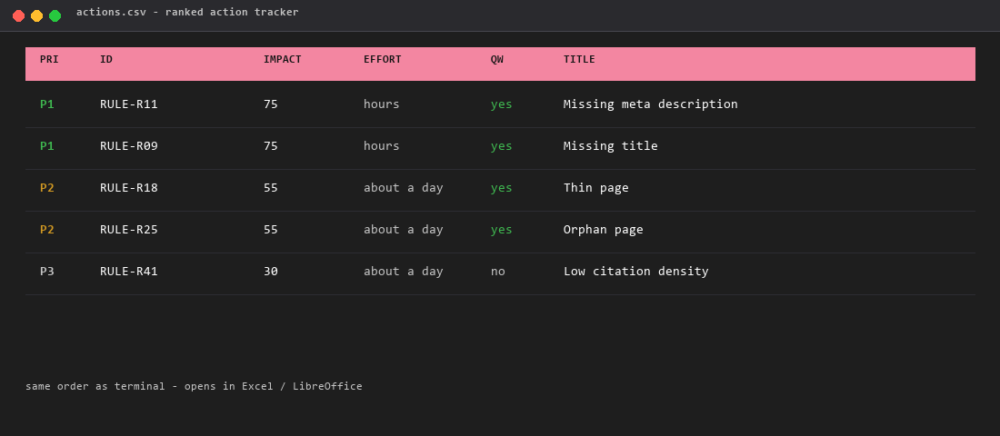
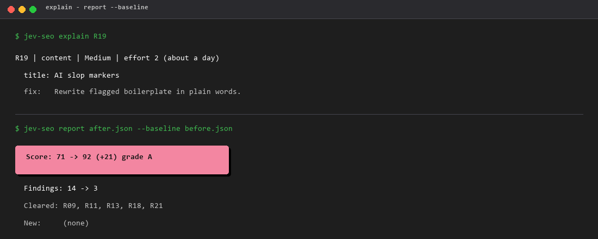
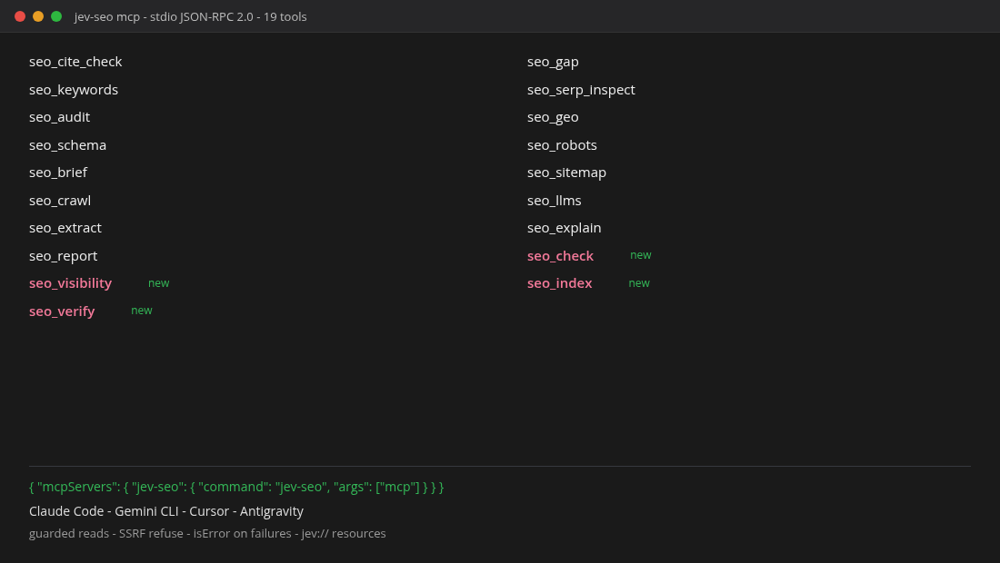
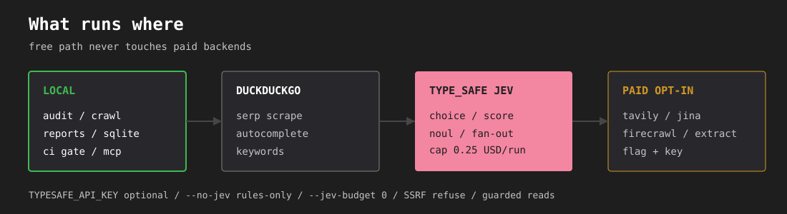
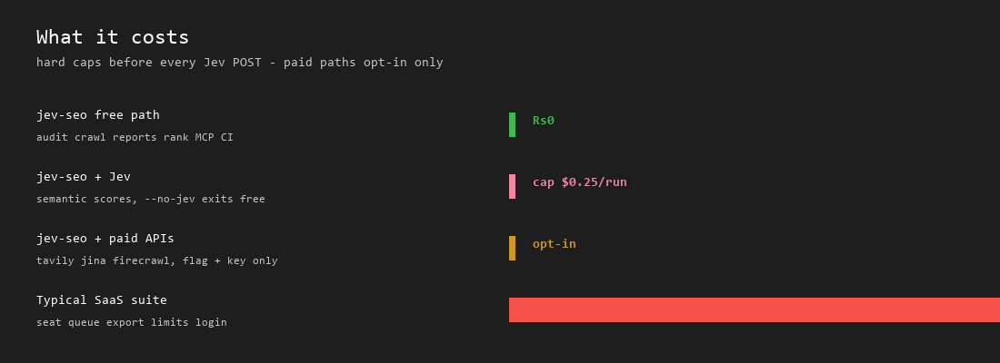

# jev-seo

Free Rust SEO and GEO CLI with a 19-tool MCP server for developers and coding agents.

**Your agent edits code. `jev-seo` verifies technical SEO, crawlability, and AI-search readiness.** 64-rule audits, live crawls, GEO heuristics, citation visibility checks, rank drift in local SQLite, Google Search Console and Bing Webmaster pulls, Search CI gates, and a 19-tool stdio/HTTP MCP server. One MIT binary. Zero subscriptions.

[](https://github.com/AkashPriyadarshii/jev-seo/blob/master/LICENSE)
[](https://crates.io/crates/jev-seo)
[](https://crates.io/crates/jev-seo)
[](https://github.com/AkashPriyadarshii/jev-seo/releases)
[](https://github.com/AkashPriyadarshii/jev-seo/actions/workflows/ci.yml)
[](https://github.com/AkashPriyadarshii/jev-seo/stargazers)
[](https://jevseo.vercel.app)

<p>
  <a href="https://www.producthunt.com/products/jev-seo?utm_source=badge-follow&utm_medium=badge&utm_source=badge-jev-seo" target="_blank" rel="noopener"></a>
</p>


---

## Quickstart

```bash
cargo install jev-seo

# Audit local documentation (deterministic rules, zero API keys)
jev-seo audit docs/ --min-pass 40

# Crawl a live website
jev-seo crawl https://example.com --max-pages 10
```

Deterministic checks (`audit`, `crawl`, `schema`, `robots`, `sitemap`, `llms`, `check`, `verify`, `fix-plan`, `explain`, `report`, `drift`, `bundle`, `watch`, `rank`, and DuckDuckGo `query`) run with **zero API keys**.

Optional credentials unlock additional workflows:

| Variable | Unlocks | Behavior when unset |
|---|---|---|
| `TYPESAFE_API_KEY` | TypeSafe Jev `Choice`/`Score`/`Noul` semantic judgments (`geo`, `audit`, `keywords`, `brief`, `link`) | Deterministic local output only; `geo` uses keyless formula |
| `GOOGLE_CLIENT_ID` + `GOOGLE_CLIENT_SECRET` | `gsc` (Search Console clicks, queries, URL inspection, winners/losers) | Command disabled |
| `BING_WEBMASTER_KEY` | `bing` (verified sites and query performance) | Command disabled |
| `JEV_SEO_LLM_KEY` + `JEV_SEO_LLM_MODEL` | Server-side AI answer checks in `seo_cite_check` (OpenAI-compatible / Perplexity / OpenRouter / Ollama) | Falls back to MCP sampling or caller-supplied `answer` |
| `TAVILY_API_KEY` / `DATAFORSEO_*` / `JINA_API_KEY` / `FIRECRAWL_*` | Opt-in search/extract/body-upgrade backends via explicit flags | Never called |

### Install options

| Lane | Command |
|---|---|
| Cargo (crates.io) | `cargo install jev-seo` |
| From source | `git clone https://github.com/AkashPriyadarshii/jev-seo.git && cd jev-seo && cargo install --path .` |
| Prebuilt binaries (Linux, macOS, Windows) | [GitHub Releases](https://github.com/AkashPriyadarshii/jev-seo/releases) |
| npx MCP wrapper | `npx -y @akashpriyadarshii/jev-seo` |

MCP client config (Claude Code, Gemini CLI, Cursor, Antigravity):

```json
{
  "mcpServers": {
    "jev-seo": { "command": "jev-seo", "args": ["mcp"] }
  }
}
```

---

## Output in practice

**Live crawl terminal**



**HTML audit scorecard**



**Action tracker CSV** (ranked by priority, impact, and effort)



**Rule explanation and baseline diff**



**19-tool MCP surface**



---

## Capabilities

- **64-rule SEO engine (`R01–R64`)**: covers Crawl, On-Page, Content, Links, Structured Data, AI Access, Performance, Security, and Canonical rules. 25 deterministic rules are **blocking** (fail CI under `--fail-on blocking`, with 4 page-tag rules downgraded to advisory on Markdown); 39 rules are advisory warnings. Editorial heuristics such as the 300-word thin-page threshold (`R18`), AI boilerplate markers (`R19`), and em-dash density (`R20`) are labeled `heuristic` rather than treated as Google Search ranking requirements.
- **Live crawling (`crawl`) & indexability (`seo_index`)**: parallel 8-worker BFS honoring `robots.txt`, seeded from `robots.txt` `Sitemap:` directives and `/sitemap.xml`. Detects broken links, redirect chains/loops, soft-404s, orphan pages, slow responses, and optional PageSpeed lab vitals (`--vitals`).
- **Search CI (`check`, `verify`, `fix-plan`, `watch`)**: policy-driven CI gate (`.jev-seo/policy.toml`), `--sarif` (GitHub Code Scanning) and `--junit` exports, deterministic `fix-plan` items verified with `verify`, and SQLite regression polling via `watch`.
- **GEO readiness vs. citation visibility vs. search performance**:
  - **GEO readiness (`geo`)**: an internal 1–10 heuristic estimating how well a page is structured for direct answers. It is **not** a citation probability or ranking prediction. Keyless mode uses a deterministic 4-part formula (`term coverage`, `answer-first`, `structure`, `depth`); `TYPESAFE_API_KEY` unlocks Jev `Choice`/`Score`/`Noul` judgments and the 5-dimension composite (`structure`, `density`, `directness`, `statistics`, `freshness`).
  - **Citation visibility (`seo_cite_check`, `seo_visibility`)**: checks whether an AI answer names, cites, or recommends your domain (`mentioned`, `cited`, `recommended`, `position`, `negated`, `sentiment`).
  - **Search performance (`gsc`, `bing`)**: pulls first-party clicks, impressions, queries, URL inspection (`gsc inspect`), and winners/losers (`gsc winners`, `gsc losers`) from Google Search Console and Bing Webmaster Tools.
- **AI crawler permissions (`robots`) & `llms.txt` (`llms`)**:
  - `robots` tracks 15 AI user-agents and separates **training crawlers** (`GPTBot`, `ClaudeBot`, `Google-Extended`, `Applebot-Extended`, `Bytespider`, `CCBot`) from **search retrieval crawlers** (`OAI-SearchBot`, `ChatGPT-User`, `Claude-SearchBot`, `anthropic-ai`, `PerplexityBot`, `Googlebot`, `Google-CloudVertexBot`, `Applebot`, `Amazonbot`). Blocking `GPTBot` does not block `OAI-SearchBot`; `Google-Extended` does not control Google Search AI Overviews.
  - `llms` is an AI-consumer compatibility and configuration check (`/llms.txt` presence/shape plus `robots.txt` AI crawler permissions). `llms.txt` is not used by Google Search and provides no special ranking benefit (`R37` is informational only).
- **XML sitemaps & hreflang (`sitemap`)**: checks HTTPS canonicals, query-parameter URLs, 50,000-URL limits, and hreflang codes (flags `en-UK` in favor of `en-GB`, and warns when multilingual alternates lack a **recommended** `x-default` fallback).
- **19-tool MCP server (`mcp`) & HTTP bridge (`serve`)**: stdio JSON-RPC 2.0 plus Streamable HTTP (`POST /mcp`, `GET /health`, `GET /plugin.json`) with `jev://` resources and guarded local reads / SSRF-checked remote fetches.

---

## Evidence and trust


| Check | Result | Rerun |
|---|---|---|
| Test suite | 142 passing unit & integration tests | `cargo test` |
| Linter | Clean under `-D warnings` | `cargo clippy --all-targets -- -D warnings` |
| Cold start (`--help`) | ~6ms | `time jev-seo --help` |
| Local audit | Sub-second on small/medium docs trees | `jev-seo audit docs/ --json` |
| Budget guard | `--jev-budget 0` sends zero Jev POSTs | `jev-seo audit docs/ --jev-budget 0` |
| Citation gate | Report writers refuse unknown `RULE-Rxx` citations | Covered in unit tests |

Scores rank work; they do not predict search rankings or traffic. Jev confidence gates print judgments only when decisive; low-confidence results print `[verify]` or withhold numbers.

### Real-run examples in the repo

- [`examples/jevseo-site/crawl.json`](examples/jevseo-site/crawl.json): 10-page live crawl with health score, areas, findings, and actions
- [`examples/jevseo-site/llms.json`](examples/jevseo-site/llms.json): AI-consumer compatibility and crawler permissions output
- [`examples/local-docs/report.html`](examples/local-docs/report.html), [`examples/local-docs/report.md`](examples/local-docs/report.md), [`examples/local-docs/findings.csv`](examples/local-docs/findings.csv): one audit exported in three formats
- [`examples/audit-good.json`](examples/audit-good.json), [`examples/audit-good.md`](examples/audit-good.md): clean-pass fixture
- [`examples/narrative.example.json`](examples/narrative.example.json) & [`references/narrative.md`](references/narrative.md): optional executive narrative contract
- Field report: [Real audit: portfolio site, 50 pages, zero spend](https://jevseo.vercel.app/real-audit.html)

---

## What's new

**v0.4.0** (released 4 October 2026):
- Search CI: `check` + `verify`, `.jev-seo/policy.toml`, `--sarif` and `--junit` exports
- Regional SERP flags (`--country`, `--language`, `--device`) on `query`
- First-party webmaster pulls: `gsc inspect/winners/losers` and `bing sites/queries`
- Rules `R59–R64` (meta-robots/X-Robots-Tag conflicts, invalid/noindexed canonicals, noncanonical sitemap URLs, render divergence heuristic); `R37` downgraded to informational
- Rich citation struct on `seo_cite_check` / `seo_visibility` (`mentioned`, `cited`, `recommended`, `position`, `negated`, `sentiment`)
- Indexability truth table (`seo_index`), 4 new MCP tools (19 total), `jev://` resources, portable `plugin.json` / `mcp.json` / `.app.json`, `GET /health` bridge probe

**v0.3.0** (2 October 2026): plugin bridge `jev-seo serve`, `capabilities --json`, `watch --diff-only`, deterministic `fix-plan`, crawl sitemap seeding, `R32`/`R08`/`R56` breadth, optional `--features js` render verification, GEO trend sparklines. Full history in [`CHANGELOG.md`](CHANGELOG.md).

---

## Workflows

### 1. Batch directory and file audit

```bash
jev-seo audit content/posts/
jev-seo audit content/posts/ --html report.html --pdf report.pdf --md report.md
jev-seo audit content/posts/ --actions-csv actions.csv --pairs-csv pairs.csv --manifest out/
```

Walks Markdown and HTML files. Flags title/description collisions, missing canonicals, missing alt text, skip-level headings, orphan pages, keyword cannibalization pairs (`--pairs-csv`), and editorial heuristics (pages under 300 words, boilerplate markers, em-dash density).

### 2. Search CI gate (`check` and `verify`)

```bash
jev-seo check docs/ --sarif results.sarif --junit junit.xml
jev-seo audit docs/ --min-pass 40 --no-jev --jev-budget 0
jev-seo fix-plan audit.json --json > plan.json
jev-seo verify R09,R13 --path docs/
```

`audit --fail-on blocking` (default) fails CI only on deterministic blocking rules, while advisory and heuristic rules print warnings unless escalated via `--forbid`. `check` applies thresholds from `.jev-seo/policy.toml`. See `.github/workflows/seo-gate.yml`.

### 3. Robots.txt, `llms.txt`, schema, and sitemaps

```bash
jev-seo robots example.com
jev-seo llms example.com
jev-seo schema content/guide.md
jev-seo sitemap https://example.com/sitemap.xml
```

- `robots` inspects 15 AI user-agents split into training vs. search retrieval roles.
- `llms` verifies `/llms.txt` presence/shape and `robots.txt` AI crawler directives.
- `schema` validates JSON-LD types (`SoftwareApplication`, `Article`, `Organization`, `Product`, etc.) and flags deprecated rich-result types.
- `sitemap` checks HTTPS URLs, query parameters, 50,000-URL limits, valid hreflang codes, and recommends `x-default` when alternates exist.

<details>
<summary><strong>More workflows</strong>: briefs, GEO heuristic, explain, baseline diff, watch, narrative</summary>

### 4. SERP-driven content brief

```bash
jev-seo brief "fast local sqlite tui" --markdown
```

Scrapes DuckDuckGo competitors (or opt-in Tavily/DataForSEO), estimates target word counts, and builds an H2 outline.

### 5. GEO readiness heuristic

```bash
jev-seo geo README.md --query "rust seo cli"
```

Outputs a 1–10 heuristic score with history tracking. Runs deterministically keyless (`term coverage`, `answer-first`, `structure`, `depth`), or uses `TYPESAFE_API_KEY` for Jev judgments and the 5-dimension composite (`structure`, `density`, `directness`, `statistics`, `freshness`).

### 6. Explain a rule and diff baselines

```bash
jev-seo explain R19
jev-seo audit docs/ --json > before.json
# ... edit content ...
jev-seo audit docs/ --json > after.json
jev-seo report after.json --baseline before.json
```

### 7. Regression watch

```bash
jev-seo watch docs/ --once --no-jev
jev-seo watch https://example.com --every 30 --diff-only
```

Compares current runs against a `watch-<slug>` SQLite baseline and emits `clean`, `regressed`, `improved`, or `baseline`.

### 8. Optional narrative contract

Place `narrative.json` beside exports (or in `--manifest`) with `executive_summary`, `strengths`, `risks`, and `plan`. Unknown `RULE-Rxx` citations fail closed. Spec: [`references/narrative.md`](references/narrative.md). Shape: [`examples/narrative.example.json`](examples/narrative.example.json).

</details>

---

## Command Reference

| Command | Description | Key Flags |
|---|---|---|
| `keywords <query>` | Autocomplete discovery and Jev intent classification | `--json` |
| `query <query>` | Live SERP scrape, Jev relevance rerank, gap analysis | `--limit <n>`, `--provider auto\|ddg\|tavily\|dfs`, `--country <code>`, `--language <code>`, `--device <mobile\|desktop>`, `--depth`, `--topic`, `--json` |
| `audit <path>` | Local file/directory audit (64 rules, orphans, pairs, exports) | `--target-query`, `--json`, `--min-pass <pct>`, `--fail-on blocking\|all`, `--forbid <ids>`, `--max-critical <n>`, `--html`, `--pdf`, `--md`, `--csv`, `--digest`, `--actions-csv`, `--pairs-csv`, `--rescore`, `--manifest <dir>`, `--no-jev`, `--jev-budget <usd>`, `--user`, `--password`, `--header` |
| `crawl <url>` | Live BFS crawl: health score, redirects, orphans, timing | `--sitemap <url>`, `--max-pages <n>`, `--fetch auto\|direct\|jina\|firecrawl`, `--max-credits <n>`, `--json`, `--diff`, `--csv`, `--rescore`, `--manifest <dir>`, `--no-jev`, `--jev-budget <usd>`, `--vitals`, `--user`, `--password`, `--header` |
| `check [path]` | Search CI: policy + audit + exit code | `--sarif <path>`, `--junit <path>`, `--json` |
| `verify <target>` | Re-run named rules or `fix-plan` JSON to confirm fixes | `--path <scope>`, `--json` |
| `fix-plan <audit.json>` | Deterministic `rule -> patch -> verify` items | `--limit <n>`, `--json` |
| `geo <target>` | GEO readiness heuristic (1–10) and composite | `--query <query>`, `--jev-budget <usd>`, `--json` |
| `schema <target>` | JSON-LD structural and deprecation validator | `--json` |
| `robots <domain>` | `robots.txt` and 15-bot AI crawler audit (training vs. search) | `--json` |
| `llms <domain>` | `/llms.txt` shape and AI crawler compatibility check | `--json` |
| `sitemap <target>` | XML sitemap, 50k limit, HTTPS, and hreflang validation | `--json` |
| `brief <topic>` | SERP competitor outline and direct-answer structure | `--limit <n>`, `--provider auto\|ddg\|tavily\|dfs`, `--markdown`, `--json` |
| `link <path>` | Internal-link suggestions per page via Jev `Choice` | `--limit <n>`, `--no-jev`, `--jev-budget <usd>`, `--json` |
| `rank` | Local SQLite rank drift tracker (`.jev-seo.db`) | `--domain <domain>`, `--query <query>` |
| `explain <id>` | Rule card for `R19` or `RULE-R19` | `--json` |
| `report <path>` | Diff two audit JSONs: score, cleared/new rules, actions | `--baseline <path>`, `--actions-csv <path>`, `--json` |
| `bundle <audit.json>` | Canonical close bundle (digest + pairs + drift) | `--out <path>` |
| `drift <op>` | Snapshot baselines (`baseline`, `compare`, `history`) | `--report <path>`, `--label <name>`, `--json` |
| `gsc <op>` | Google Search Console (`auth`, `sites`, `query`, `gap`, `inspect`, `winners`, `losers`) | `--site <url>`, `--code <code>`, `--limit <n>`, `--json` |
| `bing <op>` | Bing Webmaster Tools (`sites`, `queries`) via `BING_WEBMASTER_KEY` | `--site <url>`, `--json` |
| `watch <target>` | Regression watch against SQLite baseline (polling) | `--repo <dir>`, `--site <url>`, `--once`, `--every <min>`, `--label <name>`, `--diff-only`, `--no-jev`, `--json` |
| `serve` | Streamable HTTP MCP + plugin manifest bridge (`POST /mcp`, `GET /health`) | `--addr <host:port>` |
| `capabilities` | Machine source of truth (`version`, `rule_set`, `rules`, `mcp_tools`, `commands`) | `--json` |
| `doctor` | Environment check: version, keys, database, platform | `--json` |
| `mcp` | Stdio JSON-RPC 2.0 MCP server | (none) |

---

## Native MCP Server (19 Tools)

`jev-seo mcp` speaks stdio JSON-RPC 2.0 (`initialize`, `tools/list`, `tools/call`, `resources/list`, `resources/read`). File tools use a guarded reader (no dot-files, content extensions only) plus a Jev safety check when keyed; remote fetches block private IPs, resolved private DNS, and unsafe redirect targets.

| MCP Tool | Arguments | Purpose |
|---|---|---|
| `seo_cite_check` | `target`, `query`, `answer?` | Citation verdict (`cited`, `mentioned`, `recommended`, `position`, `negated`, `sentiment`) |
| `seo_visibility` | `target`, `query`, `answer?` | Rich citation visibility struct (alias of `seo_cite_check` struct) |
| `seo_gap` | `site`, `limit?` | Search Console gap queue: impressions × weak positions + citation history |
| `seo_keywords` | `query` | Autocomplete variants and intent classification |
| `seo_serp_inspect` | `query`, `limit?` | Live SERP titles, snippets, URLs, and gaps |
| `seo_audit` | `path` | Local Markdown/HTML audit under 64 rules |
| `seo_geo` | `target`, `query` | GEO readiness heuristic (1–10) and composite |
| `seo_schema` | `target` | JSON-LD structure and deprecation rules |
| `seo_robots` | `domain` | Live `robots.txt` for AI training and search crawlers |
| `seo_brief` | `topic`, `limit?` | Markdown brief with H2 outline |
| `seo_sitemap` | `target` | Sitemap protocol, HTTPS, and hreflang checks |
| `seo_crawl` | `url`, `max_pages?`, `sitemap?` | Live crawl for broken links, redirects, orphans |
| `seo_llms` | `domain` | `/llms.txt` compatibility and AI crawler permissions |
| `seo_extract` | `urls`, `query` | URL to markdown (key-gated paid `TAVILY_API_KEY` path) |
| `seo_explain` | `id` | Rule card for `R19` / `RULE-R19` |
| `seo_report` | `path`, `baseline?`, `baseline_label?` | Audit JSON diff: score, rules, actions, drift |
| `seo_check` | `path` | Policy-gated Search CI audit returning PASS/FAIL and blocking counts |
| `seo_index` | `url` | Indexability truth table (HTTP, robots, meta, canonical, sitemap, inlinks) |
| `seo_verify` | `rules`, `path` | Re-check rule IDs against a path (`PASS` when findings are cleared) |

**MCP Resources**: `jev://project/config`, `jev://project/health`, `jev://project/findings`.

---

## What runs where, and what it costs



| Component | Where it runs | Cost |
|---|---|---|
| 64-rule audit, HTML/PDF/MD/CSV/SARIF/JUnit exports | Local machine | Free |
| Live crawl, robots, sitemaps, `llms`, schema, `check`, `verify` | Local binary → target host | Free |
| Rank history, baselines, `watch`, `drift` | Local SQLite `.jev-seo.db` | Free |
| `gsc` / `bing` | Google / Bing APIs with your own credentials | Free |
| SERP autocomplete & web search | DuckDuckGo | Free |
| Jev `Choice` / `Score` / `Noul` judgments | TypeSafe System One | Capped by `--jev-budget` (default `$0.25/run`) |
| Tavily / DataForSEO / Jina / Firecrawl | External APIs | Opt-in only via explicit flags and keys |



---

## Architecture

```
jev-seo
├── src/
│   ├── main.rs           CLI entrypoint and command dispatch
│   ├── capabilities.rs   Single source of truth for version, rules, tools, commands
│   ├── rules.rs          Rule registry R01–R64, blocking/advisory gates, explain
│   ├── audit.rs          Batch directory/file auditor and HTML/PDF/MD/CSV writers
│   ├── crawl.rs          Live-site BFS crawler with sitemap seeding and timing
│   ├── check.rs          Search CI gate, SARIF 2.1.0, and JUnit XML writers
│   ├── fix_plan.rs       Deterministic rule -> patch -> verify plan builder
│   ├── indexability.rs   Indexability truth table across HTTP/robots/meta/canonical
│   ├── js_render.rs      Optional headless Chromium render check (--features js)
│   ├── actions.rs        Ranked actions and action-tracker CSV
│   ├── engine.rs         TypeSafe Jev client, fan-out, spend counters
│   ├── policy.rs         Confidence thresholds, GEO weights, injection pre-screen
│   ├── policy_file.rs    .jev-seo/policy.toml loader
│   ├── geo_keyless.rs    Deterministic keyless GEO readiness scorer
│   ├── llm.rs            OpenAI-compatible LLM client for server-side cite checks
│   ├── llms.rs           /llms.txt parser, shape grader, AI readiness report
│   ├── robots.rs         robots.txt and 15-bot training/search crawler analyzer
│   ├── schema.rs         JSON-LD Schema.org validator
│   ├── sitemap.rs        XML sitemap and hreflang validator
│   ├── serp.rs           DuckDuckGo, Tavily, and DataForSEO search clients
│   ├── brief.rs          SERP-driven content brief builder
│   ├── rank.rs           Local SQLite store for rank, crawl, geo, and cite history
│   ├── vitals.rs         Keyless PageSpeed Insights lab vitals (R51–R53)
│   ├── gsc.rs            Google Search Console OAuth and query/inspect client
│   ├── bing.rs           Bing Webmaster REST client
│   ├── fetch.rs          Direct / Jina / Firecrawl page fetcher with credit cap
│   ├── health.rs         Search health coverage summary
│   ├── evidence.rs       Portable jev-evidence/ JSONL snapshot writer
│   ├── manifest.rs       Frozen run.json + ledger.json and citation gate
│   ├── narrative.rs      Optional narrative.json loader and validator
│   ├── paths.rs          Guarded file reader and SSRF private-IP/DNS blocker
│   ├── watch.rs          Polling regression watcher against SQLite baselines
│   ├── mcp.rs            Stdio JSON-RPC 2.0 MCP server (19 tools + jev:// resources)
│   ├── plugin_bridge.rs  Streamable HTTP MCP and plugin manifest server
│   └── tests.rs          Unit and integration tests (142 total across crate)
├── skills/jev-audit/     Bundled agent skill
├── examples/             Real crawl, audit, and narrative fixtures
├── references/           Narrative contract specification
├── docs/assets/          README diagrams and screenshots
├── site/                 Marketing and documentation site (Vercel)
├── plugin.json           Portable agent plugin manifest
├── mcp.json              Streamable HTTP MCP manifest
├── Cargo.toml
└── CHANGELOG.md
```

---

## Development

```bash
git clone https://github.com/AkashPriyadarshii/jev-seo.git
cd jev-seo
cargo test
cargo clippy --all-targets -- -D warnings
cargo run -- audit site/ --min-pass 40
```

CI runs `cargo check --all-targets`, `cargo test --all`, Docker build verification, and the SEO gate on pushes to `master`.

---

## Limits and non-goals

- Live crawls cap at `--max-pages` (default 50) and report skipped counts in `Completeness`.
- Heuristic rules (`R18` 300-word thin content, `R19` boilerplate markers, `R20` em-dash density, `R23` cannibalization, `R24`/`R41`, `R54`, `R55`, `R58`, `R64`) are editorial signals, not guaranteed search-engine penalties.
- GEO scores are internal readiness heuristics, not citation probabilities.
- Crawls use lightweight HTTP fetches by default; JS-rendered inspection requires building with `--features js`.
- No Electron UI, hosted dashboard, or forced paid APIs.

---

## FAQ

**What is `jev-seo` in one sentence?**  
A free, MIT-licensed Rust SEO and GEO CLI plus 19-tool MCP server that audits local content, crawls live sites, checks AI-search readiness, and gates CI without a monthly subscription.

**Does it need API keys?**  
No for deterministic rules, crawls, sitemaps, robots, schema, `llms`, `check`, `verify`, `fix-plan`, and DuckDuckGo search. `TYPESAFE_API_KEY` unlocks Jev semantic scoring; `GOOGLE_CLIENT_ID`/`GOOGLE_CLIENT_SECRET` unlock `gsc`; `BING_WEBMASTER_KEY` unlocks `bing`; paid search/extract backends only run when explicitly enabled.

**Does `llms.txt` improve Google Search rankings?**  
No. Google Search does not use `llms.txt`, and `R37` is informational only. The `llms` command checks compatibility for AI tools and verifies `robots.txt` AI crawler directives.

**Is my data sent anywhere?**  
Rank history, GEO history, and baselines stay in local `.jev-seo.db`. Audits run on your filesystem. Remote requests go only to the URLs or optional APIs you explicitly invoke.

---

## Ecosystem & Contributors

- [jev-superpowers](https://github.com/AkashPriyadarshii/jev-superpowers) — Jev-gated agent engineering workflows
- [jev-curate](https://github.com/AkashPriyadarshii/jev-curate) — Jev-curated content toolkit
- [jev-git](https://github.com/AkashPriyadarshii/jev-git) — Jev reflex gates for git
- [tdlib-android](https://github.com/AkashPriyadarshii/tdlib-android) — Precompiled TDLib binaries for four Android ABIs
- [kharcha](https://github.com/AkashPriyadarshii/kharcha) — Offline-first UPI expense tracker for Android

**Contributors:** [@jerryrat](https://github.com/jerryrat) (paid search provider path and DuckDuckGo header research, PR #2).

**Author:** **Akash Priyadarshi** — Patna, Bihar, India · [GitHub](https://github.com/AkashPriyadarshii) · [Portfolio](https://akashpriyadarshi.is-a.dev) · [LinkedIn](https://linkedin.com/in/akash-priyadarshii) · [Resume](https://akashpriyadarshii.github.io/Resume/) · [X](https://x.com/Akash__ydv001)

<p>
  <a href="https://buymeacoffee.com/AkashPriyadarshi"></a>
</p>
